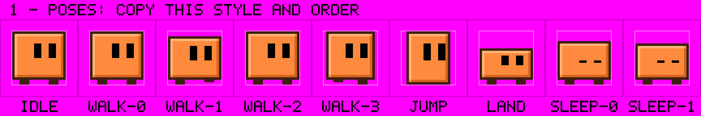
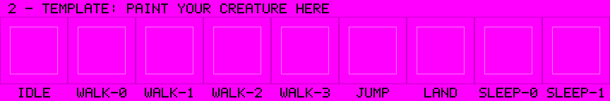

# Sprites: your own creatures, and the built-in art

## The sprite kit (for users)

A creature is nine 32×32 poses. The kit gets them painted by an **image model**
(ChatGPT, Gemini, any model that takes pictures and paints one):

1. Settings › Sprites › **Sprite kit: the new creature**: say what it is in a few
   words ("a grumpy teapot"). Name, colour and the three characters are optional;
   anything empty is the model's to choose. With an OpenRouter key, **Refine with
   AI** turns your words into a whole creature in Blocky's style and fills the form.
2. **Save Images…** (or **Copy Images**) for the two pictures, and **Copy Prompt**.
3. Paste the prompt into the image model and attach both pictures, in order:
   - `1-poses.png`: Blocky in his nine poses, labelled, to copy in style and order;
   - `2-template.png`: the same grid, empty, to paint on.
4. Save the picture it sends back and **Import…** it.

The new species appears as a card, joins the colony, blinks, walks, turns corners
and takes your colours like the built-in ones. It is called what the form says,
looks like what the picture shows, and talks as the form's description with the
form's characters.




### What the import forgives

Image models never paint exactly what was asked. The import does not trust the
picture's size or layout:

- **Any size and shape**: a 1728×288 strip, a 1024×1024 square, 1536×1024.
- **Any reading order**: one row, three rows, a 3×3 grid; read top row first, left to right.
- **Any plain paper**: magenta, white, a checkerboard, transparency. The template's
  lines and the magenta fringe round the creatures go with it.
- **Blur, anti-aliasing and noise**: each sprite pixel takes the colour most of the
  middle of its square has.
- **Labels and specks**: small patches and long words are left out.

Then every creature is snapped to the house style: a 1-pixel outline all round,
black eyes that blink, the light, shade and body colours. If fewer than nine
creatures are found, the import says how many it saw: ask the model to keep them
apart, one per cell, on plain magenta.

### The text format, for editing by hand

The kit's prompt never asks for this (models shown letters answer in letters,
not pictures), but **Import…** still reads it, for anyone who would rather type a
creature than paint one.

```
name: pip
kind: a fat green frog with big eyes            (optional)
colour: #6cbf4a                                 (optional; `color:` too; six hex digits)
character: Hopper: Bouncy and loud.             (optional, any number; "Name: persona")
pose: idle
<32 rows of 32 letters>
pose: walk-0 … walk-3, jump, land, sleep-0, sleep-1
```

| Letter | Means |
|---|---|
| `.` | nothing (also `-`, `_` and space) |
| `o` | outline, the dark line around the body |
| `b` | body, the main colour |
| `l` | light, a highlight along the top and left inside the outline |
| `s` | shade, a shadow along the bottom and right inside the outline |
| `k` | an eye pixel, black. Make each eye a vertical block; the app blinks by lowering a lid over it |
| `x` | black that never blinks (a mouth, a spot) |

`#` lines are comments; a short row of nothing is padded. The rules the import checks:

- Every pose is exactly 32 rows of 32 letters, in this order: `idle`, `walk-0`,
  `walk-1`, `walk-2`, `walk-3`, `jump`, `land`, `sleep-0`, `sleep-1`. A missing or
  unknown pose, a row of the wrong length or a strange letter is refused by name.
- The body stays inside columns 6 to 27 and rows 6 to 27 (1-based); ink outside is refused.
- Row 27 is the floor: every pose must have ink on it. The creature stands on it,
  **facing right**; the app mirrors it to walk the other way and rotates it about the
  cell's centre to turn a corner, so keep it roughly centred.
- `name` is one lowercase word (letters, digits, dashes), not a built-in name.

What the header lines do:

- `kind` is how the species is described to the model when it talks.
- `colour` makes the species always wear that colour, whatever colour slot its
  creature lands in (the shipped frog, ghost, slime, robot and mushroom do this).
  Leave it out and the creature wears the colour of its number.
- `character` lines are the species' cast; the prompt asks for three. Without any,
  the species gets one placeholder character you can edit in Settings › Talk.

### Painting by hand

Paint on `2-template.png` in any paint program and import it like a model's
picture. Or paint a sheet in the exact layout, 288×96 on magenta (`#ff00ff`): nine
pose columns, three eye rows (open, half, closed), or a whole multiple of that
size. That one is read pixel for pixel, colours as painted: use the four palette
colours (body `#ff8a3d`, light `#ffb27a`, shade `#d66220`, outline `#3b1f0f`) for
the body if you want recolouring to work.

### Where they live

An imported creature becomes a normal atlas, `<name>.png` + `<name>.json`, in the
app's sprites folder (`~/Library/Application Support/Ledgelings/sprites/<name>/` on
macOS, `%APPDATA%\Ledgelings\sprites\<name>\` on Windows), with the original `.txt`
beside it when it came from one. **Open Folder** in Settings › Sprites takes you there. Copy a folder to
another machine, of either platform, and it works there too.

## spritetool (for the built-in art)

The shipped sheets are made by `spritetool`, a small Python tool. A sheet is
described by a **recipe** (`sprites/blocky.yaml`) that declares the layout (columns
= poses, rows = how closed the eyes are), never the pixels.

```bash
pip install -r spritetool/requirements.txt

python -m spritetool template sprites/blocky.yaml   # a labelled layout PNG + a prompt, to paint into
python -m spritetool pack sprites/blocky.yaml --from painted.png   # painted sheet -> atlas for the app
python -m spritetool build sprites/blocky.yaml      # draw in code + pack + previews
python -m spritetool icon sprites/blocky.yaml       # the app icon, from the packed atlas
python -m pytest spritetool -q
```

| Command | Reads | Writes |
|---|---|---|
| `template` | the recipe | `work/<name>/template.png`, `work/<name>/prompt.txt` |
| `draw` | the recipe's `painter` | `work/<name>/painted.png` |
| `pack` | a painted sheet, at any whole-number scale | `<name>.png` + `<name>.json` in `Sources/Ledgelings/Resources/sprites/`, plus `work/<name>/contact.png` and one GIF per animation |
| `build` | the recipe | everything `draw` and `pack` write |
| `icon` | the packed atlas | `build/AppIcon.iconset`, ready for `iconutil -c icns` |

The template is the idea borrowed from `gig-tools/spritekit`: **show the layout,
don't describe it.** Every cell is outlined and named, with a dashed box the
creature must stay inside and a floor line its feet must touch, all on the exact
key colour. `pack` cuts the key colour to real 1-bit transparency itself rather
than trusting anyone to deliver clean alpha.

The recipes:

| Recipe | What | Drawn by |
|---|---|---|
| `sprites/blocky.yaml` | the square creature, 9 poses × 3 eye rows | `spritetool/painters/blocky.py` |
| `sprites/zzz.yaml` | the Z a sleeper floats, one cell | `painters/zzz.py` |
| `sprites/house.yaml` | the house, 68×60 | `painters/house.py` |
| `sprites/tea.yaml` | the tea party table with its pot and two cups, 36×28, steam in two frames | `painters/tea.py`, with the house's blocks |
| `sprites/flowers.yaml` | ten flowers, one cell each | `painters/flowers.py`, from hand-placed glyphs with the outline added in code |
| `sprites/plane.yaml` | the paper plane and the note it opens into, 18×12 | `painters/plane.py`, same glyph-plus-outline method |
| `sprites/text/*.txt` | frog, cat, ghost, slime, robot, triangle, mushroom, in the letter format | `sprites/text/make.py` (shapes plus an automatic outline, light and shade) |

The text creatures are turned into sheets by the app's own code:
`LEDGELINGS_BUILD_CREATURES=1 swift test --filter ShippedCreaturesTests` rebuilds
them, and the same test without the variable (and its Windows twin) fails if a
shipped sheet drifts from its text.

A recipe may declare a `palette`. The painter draws with exactly those colours and
they are written into the atlas JSON, which is how the app recolours a creature: it
swaps those pixels for shades of the chosen colour (light = 36 % toward white,
shade = 17 % toward black, outline = 76 % toward black) and touches nothing else.

### The atlas format

Each sheet is a PNG plus a JSON file with `cell`, `contentBox`, `variants`,
`palette`, `frames` (name → rectangle, top-left origin) and `animations`
(name → frames, fps, loop), plus the optional `kind`, `cast` and `colour`. The exact
shape, the frame lookup rule and the sizes of the shipped sheets are in
[SPEC.md §9.1](../SPEC.md). Both apps load the same files.

Two rules for any new creature: draw it **standing on a floor, facing right**, and
keep it **centred in its cell**.
